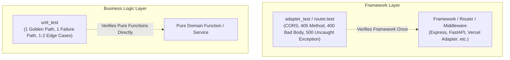

# Unit Testing Standard

## Core Philosophy

Unit tests should inspire confidence during refactoring without becoming an anchor that slows development down.

Aim for a lean test footprint:
* **1 Golden Path:** The happy path works end-to-end; valid inputs yield expected outputs and correct ordering.
* **1 Failure Path:** The primary failure mode returns the expected domain error, validation error, or error status.
* **1–2 Edge Cases:** Boundary conditions (e.g. empty collections, nil/null/undefined parameters, whitespace-only strings, unresolvable items dropped).

> [!IMPORTANT]
> **Test domain logic and behavior, not plumbing or 3rd-party code.**
> Tests that verify third-party library constructors or repeat framework-level validations provide negative value: they cost maintenance time without catching real regressions.

---

## The Layering Rule (Eliminating Framework Duplication)

In layered architectures, each concern is tested **once** at the layer that owns it.



### What Belongs Where

| Layer | Responsibility | What to Test | What NOT to Test |
| :--- | :--- | :--- | :--- |
| **Framework / Adapter / Router** | Routing, CORS, HTTP method enforcement, JSON serialization, status code mapping | Method mismatch (405), malformed payloads (400), preflight (204), unhandled exception recovery (500) | Business logic or domain rules |
| **Business Logic / Domain Services** | Pure functions, domain calculations, workflows | Valid data produces correct result, missing required inputs fail, edge case lists/filtering | HTTP method restrictions (405) or transport syntax errors (400) |
| **Third-Party Integrations** | SDK wrappers or external API clients | Payload translation, query building, error propagation, fallback logic | Whether `client := sdk.New()` or `new Client()` is non-nil |

---

## Universal Anti-Patterns to Avoid

| Anti-Pattern | Why It Hurts | What to Do Instead |
| :--- | :--- | :--- |
| **Testing 3rd-Party Constructors** (`expect(client).toBeDefined()`) | Tests whether an external library package initializes; asserts zero domain logic in your codebase. | Delete the test. |
| **Endpoint-by-Endpoint 405 / 400 Tests** | Duplicates tests for generic router/middleware logic 10+ times across different endpoints. | Verify the router or generic adapter once in a dedicated test suite. |
| **Hollow / Stub Tests** | Sets up mocks, instantiates classes, asserts nothing on the outcome; creates an illusion of coverage. | Exercise the logic and assert on returned domain values or state transitions. |
| **Testing Implementation Details** | Tests private unexported helper methods or internal state variables rather than the public contract. | Test public behavior and domain inputs/outputs. |
| **Dogmatic 100% Coverage** | Encourages writing brittle tests for unreachable error returns (e.g. JSON marshaling of static structs). | Focus on golden path, primary failure, and boundary edge cases. |
| **Network Calls in Unit Tests** | Flaky, slow, dependent on internet connectivity or external service uptime. | Intercept requests in-memory via lightweight transport interceptors or function mocks. |

---

## Language-Specific Recipes

### 1. Go (Golang)

#### Testing Pure Business Logic Directly
Avoid spinning up `httptest.NewRequest` when handlers follow Pattern A (pure business functions wrapped by an adapter):

```go
func TestGetUserEmptyCode(t *testing.T) {
	cfg := &config.Config{AppSecretKey: "secret"}
	_, err := exchangeCodeForUser(t.Context(), cfg, getUserRequest{Code: ""})
	if err == nil {
		t.Fatal("expected error for empty code")
	}
	var apiErr *httputil.APIError
	if !errors.As(err, &apiErr) || apiErr.Type != "BadRequest" {
		t.Errorf("expected BadRequest APIError, got %v", err)
	}
}
```

#### In-Memory HTTP Transport (`roundTripperFunc`)
Intercept external API calls in-memory without starting local HTTP servers:

```go
type roundTripperFunc func(*http.Request) (*http.Response, error)

func (f roundTripperFunc) RoundTrip(r *http.Request) (*http.Response, error) {
	return f(r)
}

func TestResolveTrackIDs(t *testing.T) {
	transport := roundTripperFunc(func(r *http.Request) (*http.Response, error) {
		q := r.URL.Query().Get("q")
		var trackID string
		if q == "artist:Phish track:Tweezer" {
			trackID = "track_tweezer"
		}

		res := fmt.Sprintf(`{"tracks":{"items":[{"id":"%s","name":"Tweezer"}]}}`, trackID)
		rec := httptest.NewRecorder()
		rec.Header().Set("Content-Type", "application/json")
		rec.WriteString(res)
		return rec.Result(), nil
	})

	client := spotifyclient.New(&http.Client{Transport: transport})
	ids, err := ResolveTrackIDs(context.Background(), client, "Phish", []string{"Tweezer", "Unknown"}, 2)
	if err != nil || len(ids) != 1 || ids[0] != "track_tweezer" {
		t.Fatalf("unexpected result: %v, err: %v", ids, err)
	}
}
```

---

### 2. TypeScript / JavaScript (Node, Vitest, Jest)

#### Testing Pure Domain Services
Extract business logic out of controllers/middleware and test input/output directly:

```typescript
// math.test.ts (or calculateInvoice.test.ts)
describe('calculateInvoiceTotals', () => {
  // 1. Golden path
  it('calculates totals with valid line items and discount', () => {
    const result = calculateInvoiceTotals({
      items: [{ price: 100, qty: 2 }, { price: 50, qty: 1 }],
      discountRate: 0.1,
    });
    expect(result).toEqual({ subtotal: 250, discount: 25, total: 225 });
  });

  // 2. Failure path
  it('throws ValidationError when negative quantity is provided', () => {
    expect(() =>
      calculateInvoiceTotals({ items: [{ price: 100, qty: -1 }] })
    ).toThrow(ValidationError);
  });

  // 3. Edge case
  it('returns zero totals when item list is empty', () => {
    const result = calculateInvoiceTotals({ items: [] });
    expect(result).toEqual({ subtotal: 0, discount: 0, total: 0 });
  });
});
```

#### Mocking External HTTP Calls (In-Memory)
Mock at the boundary client without starting mock servers or asserting internal fetch options:

```typescript
it('resolves track IDs and skips unknown tracks', async () => {
  const mockFetch = vi.fn().mockImplementation((url: string) => {
    if (url.includes('Tweezer')) {
      return Promise.resolve({
        ok: true,
        json: () => Promise.resolve({ tracks: { items: [{ id: 'track_1' }] } }),
      });
    }
    return Promise.resolve({
      ok: true,
      json: () => Promise.resolve({ tracks: { items: [] } }),
    });
  });

  const client = new SpotifyClient({ fetch: mockFetch });
  const ids = await resolveTrackIds(client, 'Phish', ['Tweezer', 'Unknown']);
  expect(ids).toEqual(['track_1']);
});
```

---

### 3. Python (pytest)

#### Testing Domain Functions Directly
Test pure business services directly with domain dataclasses/Pydantic schemas:

```python
def test_calculate_discount_golden():
    order = Order(items=[Item(price=100, qty=2)], promo_code="SAVE10")
    total = calculate_order_total(order)
    assert total == 180.0

def test_calculate_discount_invalid_promo():
    order = Order(items=[Item(price=100, qty=1)], promo_code="INVALID")
    with pytest.raises(InvalidPromoError):
        calculate_order_total(order)

def test_calculate_discount_empty_order():
    order = Order(items=[])
    assert calculate_order_total(order) == 0.0
```

---

## Authoring & Review Checklist

When adding or reviewing unit tests in any language:

- [ ] **Golden Path:** Is there a clear test verifying valid input produces expected output and ordering?
- [ ] **Failure Path:** Is there a test verifying the main error path (validation error, not found, or domain exception)?
- [ ] **Edge Cases (1–2 max):** Are empty inputs, boundary values, or unresolvable items handled gracefully?
- [ ] **No Redundancy:** Does this test re-test middleware or router mechanics already proven elsewhere?
- [ ] **No External Calls:** Are all external network dependencies intercepted in-memory?
- [ ] **Deterministic & Fast:** Does each test execute in `< 10ms` without race conditions or shared mutable state?

